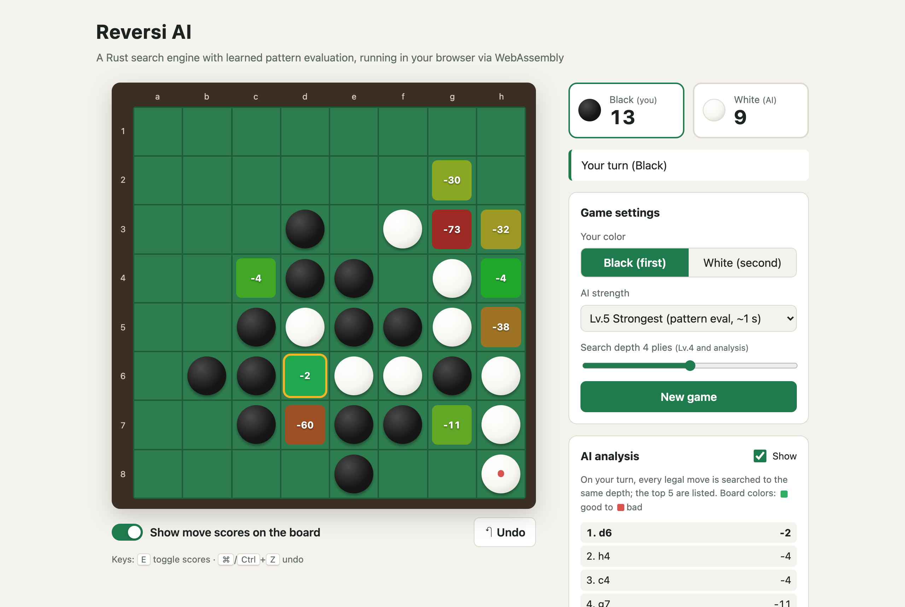
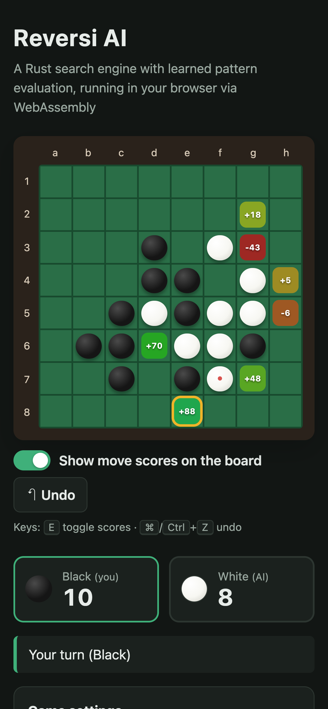
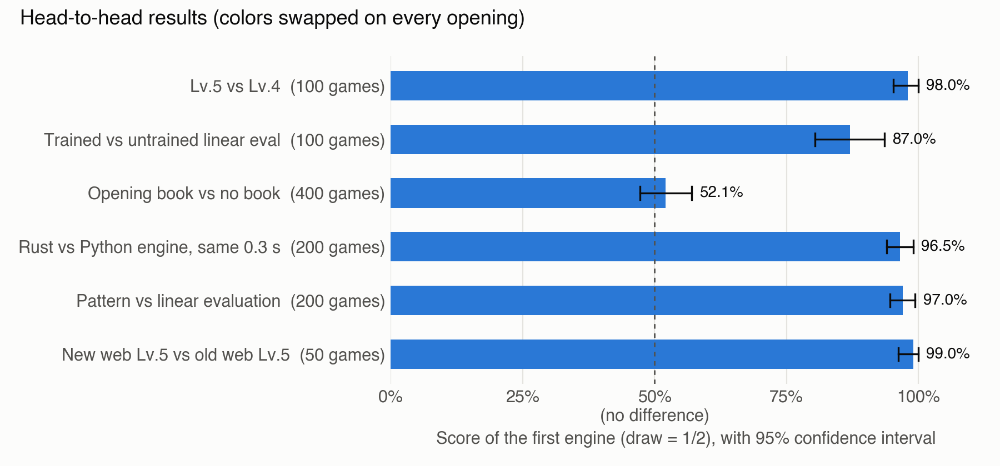
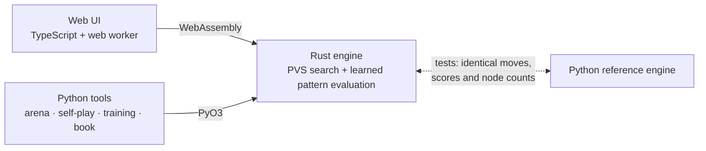
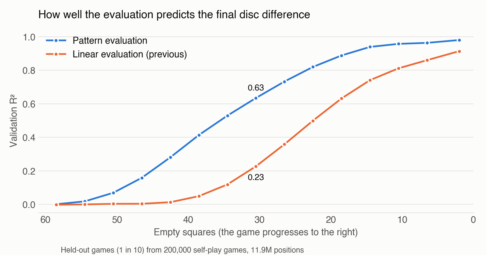

# Reversi AI

[](https://github.com/maruuu-eg-08/reversi/actions/workflows/ci.yml)
[](https://maruuu-eg-08.github.io/reversi/)

A reversi (Othello) engine that grew from a Python bitboard toy into a **Rust search engine with a learned
pattern evaluation**, running in the browser through **WebAssembly**. Every strength claim below is
backed by head-to-head matches with 95% confidence intervals.

**▶ Play it in your browser: https://maruuu-eg-08.github.io/reversi/**

<p align="center">
  
  &nbsp;
  
</p>

On your turn every legal move is searched and colored by its score (green = good, red = bad).
You can undo moves, copy the game record, and see the name of the opening being played.

## Highlights

| | |
|---|---|
| **Learned pattern evaluation** | 11 board shapes (84 rotated/reflected instances) × 15 game stages, trained on self-play games over three rounds of a learning loop (each round's engine plays the next round's games). Beats the linear evaluation **194–6 (97.0%)**; round 2 beats round 1 **84.4%**, round 3 beats round 2 **54.8%**. |
| **Rust engine, bit-identical to Python** | Iterative-deepening PVS with a transposition table and exact endgame solving. **~80× faster** than the Python version while returning the same move, score *and node count*. |
| **Runs in the browser** | The Rust engine compiled to WebAssembly (145 KB) replaced a 10 MB Python runtime (Pyodide). Lv.5 now reads 9–11 plies per second in the browser. |
| **Opening book** | 7,081 positions analyzed 10 plies deep, stored once per symmetry class. Its main line rediscovers the human *Tiger → Aubrey* opening. |
| **Measured, not guessed** | `arena.py` plays every opening with colors swapped and reports win rate, 95% CI and Elo. Results that showed no significant gain are reported as such. |
| **Tested** | 148 Python tests (including Rust/Python equality), 35 Rust tests, and a Node smoke test of the built WebAssembly, all in CI. |

## Results

<p align="center">
  
</p>

| Match | Games | W–L–D | Score (95% CI) | Mean disc diff |
|---|---|---|---|---|
| Lv.5 (0.3 s/move) vs Lv.4 (depth 4) | 100 | 98–2–0 | 98.0% (95.3–100%) | +43.6 |
| Trained vs untrained linear evaluation (0.3 s) | 100 | 87–13–0 | 87.0% (80.4–93.6%) | +35.3 |
| Opening book vs no book (0.3 s) | 400 | 202–185–13 | 52.1% (47.2–57.0%), **not significant** | +1.5 |
| Rust vs Python engine, same 0.3 s | 200 | 193–7–0 | 96.5% (94.0–99.0%) | +40.2 |
| **Pattern vs linear evaluation** (both Rust, 0.3 s) | 200 | 194–6–0 | **97.0% (94.6–99.4%)** | +32.6 |
| New web Lv.5 vs old web Lv.5 (1 s, approximate*) | 50 | 49–0–1 | 99.0% (96.2–100%) | +46.1 |
| **Self-play round 2 vs round 1** (round 1 + 2 data, 0.3 s) | 400 | 333–58–9 | **84.4% (80.8–87.9%)** | +12.8 |
| Self-play round 2, round 2 data only, vs round 1 (0.3 s) | 400 | 310–76–14 | 79.2% (75.3–83.2%) | +11.1 |
| **Self-play round 3 vs round 2** (round 3 data only, 0.3 s) | 2,000 | 1038–846–116 | **54.8% (52.6–57.0%)** | +1.3 |

Every opening (a few random moves from the start) is played twice with colors swapped, which cancels
first-move advantage and opening luck. *The web comparison reproduces both versions natively; in the
browser WebAssembly runs at roughly half native speed.

## How it works



### 1. Bitboards and search

The board is two 64-bit integers (player, opponent); move generation and flipping are shift-and-mask
operations, verified with perft counts up to 8 plies (390,216 positions) and against a naive implementation.

Lv.5 searches with **negamax + principal variation search**, **iterative deepening** under a time limit,
a **transposition table** that also orders moves, **fastest-first ordering** (moves that leave the
opponent fewest replies first) and an **exact endgame solve** once the remaining squares fit in the search.

Why alpha-beta rather than Monte Carlo tree search: reversi has few moves per position, a learned
evaluation that works well and solvable endgames (see [docs/DESIGN.md](docs/DESIGN.md#why-alpha-beta-and-not-monte-carlo-tree-search)).

### 2. Pattern evaluation

The original evaluation was linear in four features (positional weights, mobility, discs, frontier discs).
It is replaced by tables that score **every configuration of a board shape**:

- **Shapes**: rows 2–4, diagonals of length 4–8, edge + X-squares (10 squares), corner 3×3, corner 2×5.
- **Exact symmetry by construction**: all 84 distinct (squares, reading order) images under the 8 board
  symmetries are evaluated, so even a mirror-symmetric edge is read from both ends. The evaluation is
  therefore exactly symmetric under rotation and reflection *for any weights* (property-tested).
- **15 stages** by move number, each with its own 167,265 weights, stored as 1/64-disc **integers** so
  Python and Rust agree exactly whatever the summation order.

**Training data** (`gen_data.py` → Rust `selfplay.rs`): 200,000 self-play games with 8–20 random opening
moves, depth-6 search in the middlegame and exact solving from 14 empty squares. Each position is labeled
with the final disc difference under perfect play from the solve point. Games are seeded by game number,
so the data is identical for any thread count, and an interrupted run resumes where it stopped.

**Training** (`train_patterns.py` → Rust `train.rs`): per stage, L2-regularized least squares
`(XᵀX + λI) w = Xᵀy` solved with **Jacobi-preconditioned conjugate gradients** on the sparse design
matrix (86 non-zeros per row). Rows and columns are processed independently and dot products are summed
in fixed-size chunks, so the result is **deterministic for any number of threads**. Training on 11.9 M
positions takes 136 s; λ = 30 was chosen on a held-out set (1 game in 10).

<p align="center">
  
</p>

The pattern evaluation is ~5× slower per node and searches about 1.7 plies shallower in the same time,
yet it wins 97% of games: **evaluating positions well matters more than searching deeper.**

**A second round of self-play.** The first data set was played by the old linear evaluation. Letting the
trained pattern evaluation play 200,000 new games (`gen_data.py --patterns auto`, ~2 h 15 min at ~24
games/s) and retraining gave a clearly stronger engine:

| Weights | Training data | vs round-1 weights (400 games, 0.3 s) |
|---|---|---|
| Round 2, new data only | 200,000 games played by the pattern evaluation | 79.2% (75.3–83.2%) |
| **Round 2, old + new data (adopted)** | 400,000 games, 23.9 M positions (training: 5 min) | **84.4% (80.8–87.9%)**, Elo +293 |

Combining both rounds beat using only the new games: the new games are higher-quality but cover fewer of
the positions a weaker opponent creates.

**A third round, and diminishing returns.** The round-2 engine played another 200,000 games (seed 2,
~24 games/s) and three candidates were trained (λ = 30) and matched against the round-2 weights:

| Weights | Training data | vs round-2 weights (0.3 s) |
|---|---|---|
| **Round 3, new data only (adopted)** | 200,000 games, 12.0 M positions (training: 2 min) | 53.5% (48.6–58.4%) in 400 games; **54.8% (52.6–57.0%) in 2,000 games**, Elo +33 |
| Rounds 2 + 3 | 400,000 games | 52.8% (47.9–57.6%), not significant |
| Rounds 1 + 2 + 3 | 600,000 games | 51.5% (46.6–56.4%), not significant |

All three were ahead but none was significant in 400 games, so the best one was re-tested on 1,000 fresh
openings (2,000 games), where the gain is small but real. Two things changed from round 2: the gain
shrank from +293 to +33 Elo (the loop is converging for this model size), and old data no longer helps
(a likely reason: round-1 games, played by the weak linear evaluation, mostly cover positions that strong
players now avoid).

### 3. Rust engine, verified against Python

The hot path of `strong_ai.py` (move generation, evaluation, search) is ported to Rust (`backend_rust/`)
and exposed to Python with **PyO3**. `StrongAI` uses it automatically when installed and falls back to
pure Python otherwise.

At a fixed depth both engines return the **same best move, the same score (bit-identical floats) and the
same number of searched nodes** on random middlegame and endgame positions (`tests/test_rust_engine.py`);
equal node counts mean move ordering, the transposition table and pruning run in exactly the same order.

| Depth | Python | Rust | Speed-up |
|---|---|---|---|
| 8 | 1.50 s/position (0.13 M nodes/s) | 0.018 s/position (10.9 M nodes/s) | ~84× |
| 10 | 10.0 s/position (0.12 M nodes/s) | 0.129 s/position (9.6 M nodes/s) | ~78× |

**Incremental pattern evaluation.** Profiling showed that 61% of the search time went into rebuilding all
84 pattern indices at every evaluated position. The Rust search now keeps the indices up to date as moves
are made (only the instances that contain the placed or flipped squares change) and switches the updates
off once the search reaches the end of the game. Results are unchanged: the same moves, scores and node counts
on 30 fixed positions (24 middlegame positions at depths 8 and 10, and 6 endgame solves with 14–18 empty
squares). Lv.5 with pattern evaluation got faster (Apple M3, one core; positions in
`backend_rust/examples/midgame_positions.txt`; timed through the Python module, and
`cargo run --release --example bench_search` reruns the fixed-depth searches in Rust):

| Lv.5 with pattern evaluation | Before | After | Speed-up |
|---|---|---|---|
| Depth 8, 24 middlegame positions | 1.28 s (1.84 M nodes/s) | 0.80 s (2.96 M nodes/s) | 1.61× |
| Depth 10, 24 middlegame positions | 10.9 s (1.94 M nodes/s) | 7.2 s (2.95 M nodes/s) | 1.52× |
| Average depth completed in 0.3 s / 1 s (24 positions × 3 runs) | 9.54 / 10.92 | 9.94 / 11.26 | +0.4 / +0.3 plies |

Rebuilding the opening book went from **2.5 hours** (GitHub Actions + PyPy) to **2 min 12 s**, producing a
byte-for-byte identical file.

### 4. WebAssembly in the browser

The same crate compiles to `wasm32-unknown-unknown` with plain `extern "C"` exports (no wasm-bindgen):
64-bit boards travel as JavaScript `BigInt`s, multi-value results through a shared `f64` buffer, and the
weights and book are copied in through `alloc`. Rust's `Instant` does not exist in the browser, so the clock
is imported from JavaScript's `performance.now()`. Lv.1–4, the analysis view, the opening book and opening
names were ported too, and pytest checks that each returns exactly what the Python version returns.

### 5. Opening book and opening names

`build_book.py` stores every position up to ply 6 and, up to ply 8, the AI's best move against the
opponent's top 3 replies, each searched 10 plies deep. Positions are stored in **canonical form**
(the smallest of the 8 symmetric images), cutting the table ~8× and making the book work in any
orientation. The build is deterministic and resumable.

| Measurement | Result |
|---|---|
| Book vs no book (400 games) | 52.1% (47.2–57.0%), not significant |
| Pattern-evaluation book vs linear-evaluation book (400 games) | 53.0% (48.1–57.9%), not significant |
| Book move vs 0.3 s search on 400 openings | agree 26%; when different, the short search loses 2.85 discs by a depth-10 evaluation |

The book changes moves a lot but barely changes results: the games start from 6 random moves, so the
book is used for only 1–2 moves per game. Its practical value is instant opening replies.
Opening names (77 lines from [Robert Gatliff's list](https://www.samsoft.org.uk/reversi/openings.htm))
are recognized in any orientation.

## Engineering notes

- **`sum()` changed in Python 3.12.** Float `sum()` became compensated summation, so precomputed weight
  tables differed in the last bit between Python versions and from Rust. The tables now add in an explicit
  order, and pattern weights are integers.
- **Mixed cache on GitHub Pages.** Pages caches files for 10 minutes, so a fresh deploy could load new
  HTML with old JavaScript. The build stamps a content hash on every asset URL and fails if a relative
  import is left unversioned.
- **Long jobs are resumable and reproducible.** Data generation, book building and training are
  deterministic and can be interrupted and resumed with identical output.
- **Honest results.** The opening book did not make the engine measurably stronger, and the README says so.
  That result is what pointed to the evaluation function as the bottleneck.

## Running it

```bash
pip install -r requirements.txt
cd backend
python gui.py                                   # play with a pygame GUI
python main.py                                  # play in the terminal
python arena.py lv5:0.3 lv4 -n 50               # 50 openings x 2 colors = 100 games
python arena.py lv5:0.3 lv5:0.3:patterns=off -n 100   # pattern vs linear evaluation
python arena.py lv5:0.3 lv5:0.3:engine=python -n 100  # Rust vs Python engine
```

**Rust engine** (Rust 1.87+): makes Lv.5, training and all tools use the Rust engine.

```bash
pip install ./backend_rust            # or: cd backend_rust && maturin develop --release
cd backend_rust && cargo test --release
```

**Reproduce the pattern evaluation** (Rust engine required; ~3.5 h on 8 cores in total):

```bash
cd backend
python gen_data.py --games 200000 --out ../data/selfplay-200k.bin                       # round 1 (linear eval)
python train_patterns.py --data ../data/selfplay-200k.bin --out ../data/round1.bin
python gen_data.py --games 200000 --seed 1 --patterns ../data/round1.bin --out ../data/selfplay-gen2-200k.bin
python train_patterns.py --data ../data/selfplay-200k.bin ../data/selfplay-gen2-200k.bin --out pattern_weights.bin
python build_book.py --depth 10 --full-plies 6 --plies 8 --patterns pattern_weights.bin
```

**Web version** locally:

```bash
rustup target add wasm32-unknown-unknown
cd frontend && npm install
npm run serve      # builds Rust -> WebAssembly and serves http://localhost:8000
npm test           # runs the built engine in Node
```

**Tests and lints**: `pytest`, `ruff check .`, `cargo fmt --check`, `cargo clippy -- -D warnings`.

## Project layout

```
backend/                Python engine and tools (the reference implementation)
  bitboard.py           bitboard board
  strong_ai.py          Lv.5 search (uses the Rust engine when installed)
  patterns.py           pattern evaluation; pattern_weights.bin(.json) = trained weights and metrics
  gen_data.py           self-play training data      train_patterns.py   weight training
  opening_book.py       symmetric opening book       build_book.py       book generator
  openings.py           named openings               arena.py            AI-vs-AI matches
  tune_eval.py          linear-evaluation fitting    evaluate_book.py    book analysis
backend_rust/src/       Rust engine
  board.rs search.rs eval.rs pattern.rs     search and evaluation
  selfplay.rs train.rs                      data generation and training
  levels.rs book.rs openings.rs wasm.rs clock.rs   browser build
  lib.rs                                    Python bindings (PyO3)
frontend/               TypeScript UI, WebAssembly worker, build and smoke test
tests/                  pytest, including Rust/Python equality tests
.github/workflows/      CI, GitHub Pages deploy, opening-book build
```

## Roadmap

- A rebuilt opening book with the round-3 weights.
- A larger evaluation model (e.g. a small neural network), since self-play with the current pattern model is
  converging (+293 Elo in round 2, +33 in round 3).
- A dedicated endgame solver (parity ordering, special code for the last few empty squares).
